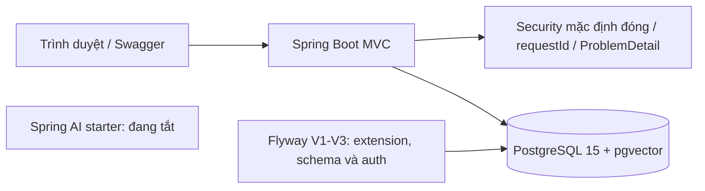

# DocuMind Backend

Backend Java cho hệ thống hỏi đáp tài liệu có trích dẫn. Hiện có nền tảng local, schema/tầng dữ liệu và xác thực Phase 3; upload, worker và RAG thuộc các phase tiếp theo. Hợp đồng sản phẩm nằm ở `../PRD.md`, `../TECH_SPEC.md` và `../BE Implementation Plan.md`.

## Công nghệ và phạm vi

| Thành phần | Phiên bản/quyết định |
|---|---|
| Java | 21 |
| Maven Wrapper | 3.10.0, không cần cài Maven toàn máy |
| Spring Boot | 4.1.2 |
| Spring AI | 2.0.1; giữ OpenAI starter nhưng **tắt toàn bộ model**, không cần API key |
| springdoc | 3.2.0 |
| PostgreSQL local | Container có sẵn `local_postgres`, major 15; đã quan sát bản 15.17 |
| pgvector | 0.8.7 |
| Testcontainers | 2.0.5, do Spring Boot BOM quản lý |
| Kiểm thử | JUnit 6, MockMvc, Failsafe, JaCoCo 0.8.14 |

Mô-đun: `auth`, `document`, `ingestion`, `retrieval`, `chat`, `usage`, `common`. Phase 3 cung cấp `/api/v1/auth/{csrf,register,login,refresh,logout}`; các API tài liệu/chat vẫn chưa triển khai. Embedding đã chọn `text-embedding-3-small` với 1.536 chiều; AI vẫn tắt. Chat model và phương án rerank chưa chọn.



## Chạy local với PostgreSQL đang có

Yêu cầu: JDK 21, Docker Desktop đang chạy, PowerShell. Chạy lệnh từ thư mục chứa `pom.xml`. Không thay image/volume hay xóa database của các dự án khác.

```powershell
docker start local_postgres
docker exec local_postgres pg_isready -U postgres
```

`postgres:15-alpine` không có sẵn pgvector ở môi trường đã kiểm tra. Bổ sung extension một lần bằng script được lưu trong repo:

```powershell
docker cp deploy/postgres/install-pgvector.sh local_postgres:/tmp/documind-install-pgvector.sh
docker exec --user root local_postgres sh /tmp/documind-install-pgvector.sh
```

Script ghim pgvector 0.8.7, tải source chính thức qua HTTPS, build và gỡ build dependencies; chỉ cài thư viện extension, chưa bật vào database nào. **Restart** giữ được thư viện đã cài; nếu **recreate** container từ image gốc phải chạy lại script. Dữ liệu vẫn ở volume PostgreSQL hiện có; không chạy `docker compose down -v` của stack dùng chung.

Tạo database và credential riêng:

```powershell
powershell -NoProfile -ExecutionPolicy Bypass -File deploy/postgres/setup-local.ps1
.\mvnw.cmd -B -ntp spring-boot:run "-Dspring-boot.run.profiles=dev"
```

Setup tạo role `documind` với mật khẩu ngẫu nhiên, hai database `documind` và `documind_phase1_test`, rồi lưu `.env` bị Git bỏ qua. Script không ghi đè role/database đã tồn tại nếu chưa có `.env`, và không in credential. Nếu `.env` đã có, script giữ nguyên; có thể điền thủ công theo `.env.example` khi container dùng password file hoặc cấu hình khác.

Trước khi chạy app Phase 3, tạo khóa ký local một lần (script giữ khóa hiện có):

```powershell
powershell -NoProfile -ExecutionPolicy Bypass -File deploy/setup-auth-local.ps1
```

`JWT_SECRET` là Base64 của ít nhất 32 byte ngẫu nhiên, chỉ lưu trong `.env` bị Git bỏ qua. Ngoài profile dev, phải cấu hình `AUTH_ALLOWED_ORIGINS` rõ ràng. Dev mặc định chấp nhận Origin `http://localhost:5173` và `http://localhost:8080`; frontend gọi `/api` qua Vite proxy. Nếu chạy local trên port khác, cập nhật Origin tương ứng. Cookie chỉ bỏ Secure khi dev là profile duy nhất và mọi Origin được phép đều là HTTP local.

Ứng dụng tự đọc `.env` theo cú pháp Java properties; không cần export mật khẩu ra terminal. Runtime dùng role `documind`; Flyway dùng tài khoản migration riêng. Migration V2 cấp quyền dữ liệu cho chủ database; nếu runtime dùng role khác chủ database thì quản trị viên phải cấp quyền SELECT/INSERT/UPDATE/DELETE tương ứng. Không dùng tài khoản superuser làm runtime production.

V3 chuẩn hóa email người dùng đã có. Nếu nhiều tài khoản trùng email sau chuẩn hóa, migration dừng và rollback; cần xử lý dữ liệu trùng thủ công trước khi chạy lại, không tự gộp tài khoản.

Một lệnh khởi chạy app sau setup: `./mvnw spring-boot:run -Dspring-boot.run.profiles=dev` trên Linux/macOS, hoặc lệnh PowerShell ở trên. Có thể chạy JAR sau `verify`:

```powershell
java -jar target/documind-backend-0.0.1-SNAPSHOT.jar --spring.profiles.active=dev
```

## Endpoint và profile

| URL local | Kết quả hiện tại |
|---|---|
| `http://localhost:8080/actuator/health` | Health tối thiểu, không lộ chi tiết DB |
| `http://localhost:8080/actuator/health/liveness` | Trạng thái tiến trình |
| `http://localhost:8080/actuator/health/readiness` | Gồm readiness state, DB và pgvector |
| `http://localhost:8080/swagger-ui/index.html` | Swagger UI ở dev/test |
| `http://localhost:8080/v3/api-docs` | Tài liệu OpenAPI ở dev/test, gồm auth |
| `/api/v1/auth/csrf` | GET bootstrap CSRF, không cần JWT |
| `/api/v1/auth/{register,login,refresh,logout}` | POST cần Origin và signed double-submit CSRF |
| Các `/api/v1/**` khác | Cần Bearer JWT; tài liệu/chat chưa có controller |

`dev`: Swagger bật. `test`: DB test riêng hoặc Testcontainers. `prod`: Swagger tắt, shutdown graceful, không có secret/default credential. Không chỉ định profile vẫn giữ Security đóng và Swagger tắt. Health liveness không thay thế readiness.

Mỗi request nhận `X-Request-ID`; header hợp lệ tối đa 64 ký tự được giữ, giá trị không an toàn được thay UUID. JSON logging có requestId, method/path/status/duration; dev dùng log console dễ đọc. Không ghi body/query string, token hoặc mật khẩu. Lỗi thông thường/security có `code` và `requestId`, không lộ stack trace. Auth trả `Cache-Control: no-store`; API chỉ dùng Bearer không đòi CSRF.

Lỗi ứng dụng được khai báo bằng `ErrorCode` và phát sinh qua `AppException`; `GlobalExceptionHandler` chuyển lỗi thành `ProblemDetail`. Lỗi validation body có thể kèm `errors` theo tên trường với thông báo chung, không trả giá trị đã nhập. Với lỗi mới, thêm mã/status/nội dung an toàn vào `ErrorCode` rồi bổ sung kiểm thử contract. Lỗi xảy ra trong security filter dùng `SecurityProblemWriter` cùng danh mục mã lỗi, vì filter chạy trước MVC. Tránh đưa giá trị đầu vào, token hoặc chi tiết exception vào response/log.

Khi thử auth bằng Swagger hoặc client cùng origin: GET `/api/v1/auth/csrf`, giữ cookie và chép `token` vào header `X-CSRF-TOKEN` cho mỗi POST auth. Register trả 201 user và chưa đăng nhập; login/refresh trả access token trong JSON và refresh cookie HttpOnly. Client cần gửi đúng Origin trong allowlist; browser tự đặt Origin. Refresh race trả 409 với Retry-After: 1 và không thay cookie; logout không cần access token còn hạn. Refresh/logout có nhiều cookie refresh cùng tên trả 400, không thay cookie. Register và login được giới hạn độc lập mặc định 10 request mỗi 60 giây cho mỗi IP trực tiếp, trong từng process; vượt giới hạn trả 429.

## Kiểm thử

```powershell
.\mvnw.cmd -B -ntp verify "-Ddocumind.testcontainers=true"
python -m pip install -r eval/requirements.txt
python eval/validate.py
python -m unittest discover -s eval -p "test_*.py"
```

Surefire chạy unit test, Failsafe chạy `*IT`; `verify` thất bại nếu integration test lỗi. Local lấy `TEST_DB_*` từ `.env` hoặc environment, chỉ chấp nhận tên database `documind_phase1_test`; không dùng database dev để chạy test. Không có cấu hình DB test thì tự tạo PostgreSQL pgvector bằng Testcontainers và dọn sau test; không skip test nếu Docker chưa chạy.

Kiểm tra đúng đường chạy CI bằng container tạm, dù máy có `.env`:

```powershell
.\mvnw.cmd -B -ntp verify "-Ddocumind.testcontainers=true"
```

Nếu database test local đã chạy bản V2 cũ trước khi V2 được chỉnh theo review, Flyway sẽ báo sai checksum. Không dùng `repair` đơn thuần vì thao tác đó không áp dụng những thay đổi schema. Dùng Testcontainers như lệnh trên; nếu muốn dùng lại database test cũ, cần có phương án nâng cấp hoặc tạo lại DB test sau khi xác nhận dữ liệu có thể bỏ. Không tự xóa database dev hoặc database khác.

Lần đầu Testcontainers có thể tải image test `pgvector/pgvector:0.8.7-pg15` và Ryuk; đây là database tạm cho kiểm thử, không thay container local. CI GitHub Actions dùng JDK 21, `verify` và validator eval, không cần API key hay secret DB. Workflow đã chuẩn bị; CI trên GitHub chỉ được xác nhận sau khi thực sự chạy trên remote.

Báo cáo: `target/surefire-reports`, `target/failsafe-reports`, `target/site/jacoco/index.html`. Tests kiểm chứng context, Flyway/pgvector, phép toán vector, AI không tạo model, health/readiness, Swagger, route mặc định đóng và lỗi không rò exception text. Vector 3 chiều trong test chỉ kiểm tra extension, không chọn chiều embedding cho sản phẩm.

## Compose cho máy chưa có PostgreSQL

Theo yêu cầu hiện tại, local tái sử dụng `local_postgres`. `compose.yaml` chỉ là phương án có thể tái lập trên máy mới; profile `standalone-db` không tự chạy container DB thứ hai. Điền `POSTGRES_PASSWORD` trong `.env`, sau đó:

```powershell
docker compose --profile standalone-db up -d db
```

DB mới dùng pgvector 0.8.7/PostgreSQL 15, port loopback 5433 mặc định, persistent volume riêng và health check. Cấu hình `DB_URL` trỏ port 5433; bootstrap migration có thể dùng user `postgres` với password đã đặt cho container mới. Tạo runtime role riêng trước khi chạy ứng dụng. Nếu dùng tests local, tạo riêng `documind_phase1_test`; hoặc bỏ TEST_DB_* để dùng Testcontainers. Không dùng lại credential của container `local_postgres` cho container mới.

## Eval và quyết định còn lại

`eval/README.md` mô tả corpus 20 file tiếng Việt (`synthetic-vi-v2`) và 25 câu hỏi (`questions-vi-v3`); PDF nhúng Noto Sans. Q06–Q10 là multi_passage (nhiều đoạn, không bắt buộc nhiều tài liệu); Q21–Q25 được rà trên toàn bộ 20 tài liệu. `eval/REVIEW.md` có mọi thay đổi, lịch sử, đáp án và nguồn để duyệt; `eval/no_evidence_audit.json` lưu đối chiếu toàn corpus. Dữ liệu giữ **PENDING_REVIEW**; chưa chạy RAG/model thật và không tự tuyên bố điểm chất lượng đạt.

Quyết định chi tiết: `docs/decisions/0001-local-foundation.md`, `docs/decisions/0002-data-foundation.md`. Trước triển khai VPS phải chốt domain/tài nguyên. Không đưa `.env`, file upload hoặc API key vào Git.

Các lỗi thường gặp:

- Kết nối DB bị từ chối: kiểm tra Docker, `docker start local_postgres`, URL/port và credential trong `.env`.
- `extension vector is not available`: chạy installer trong đúng container; Flyway không tự cài thư viện hệ điều hành.
- Không có quyền tạo extension: điền `DB_MIGRATION_USERNAME/PASSWORD`, runtime role không cần superuser.
- Docker pipe permission denied: cấp quyền Docker cho terminal/người chạy kiểm thử.
- Port 8080 đang dùng: đặt `SERVER_PORT` trong `.env`.
